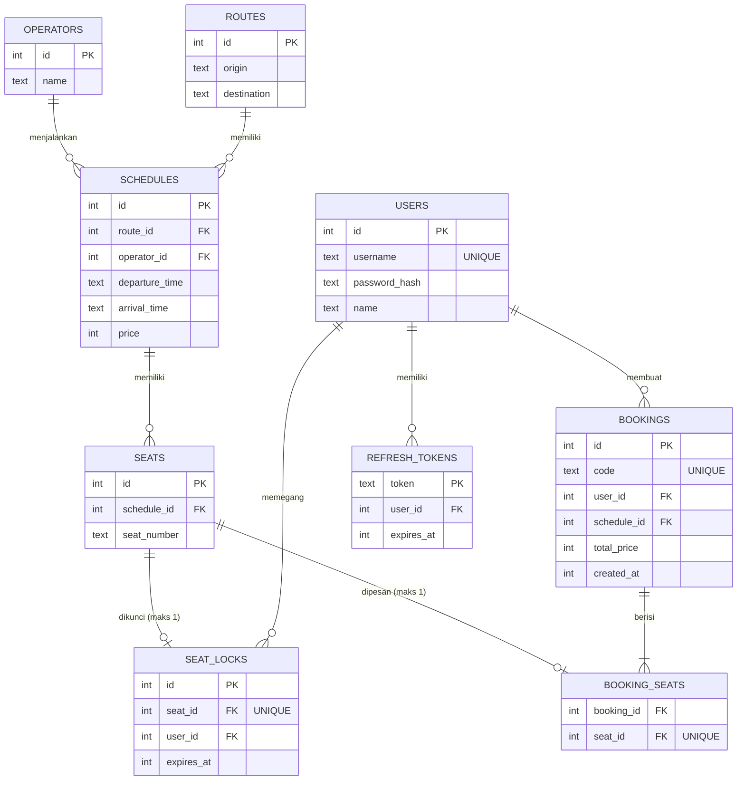

# Mini Booking Service

Aplikasi pemesanan kursi bus sederhana: cari jadwal, pilih kursi, kunci kursi sementara selama 5 menit, lalu konfirmasi pemesanan. Fokus utama proyek ini adalah **penanganan race condition**, sehingga dua request yang datang bersamaan tidak bisa mengunci atau memesan kursi yang sama.

| Bagian | Teknologi |
|---|---|
| Backend | Node.js 20, Express, better-sqlite3 (SQLite), jsonwebtoken, bcryptjs |
| Frontend | Nuxt 4 (Vue 3), mode SPA |
| Test | Jest + Supertest |
| Lainnya | Docker Compose, express-rate-limit |

## Fitur

**Wajib**

- REST API untuk Operator, Rute, Jadwal, Kursi, dan Pemesanan
- Cari jadwal berdasarkan rute dan tanggal
- Lihat ketersediaan kursi (tersedia / dikunci / terisi)
- Kunci kursi sementara selama 5 menit (seat lock)
- Konfirmasi pemesanan sebelum lock kedaluwarsa
- Pelepasan lock otomatis saat kedaluwarsa
- Penanganan race condition (transaksi `BEGIN IMMEDIATE` + constraint `UNIQUE`)
- Autentikasi JWT dengan user seed (tanpa registrasi)
- Frontend lengkap: login → cari jadwal → pilih kursi → ringkasan → konfirmasi → status hasil
- Unit test: sukses, kursi terkunci, tidak terautentikasi, lock kedaluwarsa
- Dokumentasi API (Markdown + Postman collection)

**Bonus**

- Docker Compose untuk backend dan frontend
- Rate limiting pada endpoint pencarian jadwal (30 request/menit per IP)
- Load test: 50 request paralel ke 1 kursi
- Refresh token dengan rotasi, dan auto-refresh di frontend
- Polish UX: loading state, tombol di-disable saat proses, pesan error yang jelas, countdown lock, polling status kursi tiap 5 detik

---

## Akun Demo

Tidak ada registrasi. Gunakan akun hasil seed:

| Username | Password | Keterangan |
|---|---|---|
| `budi` | `password123` | User demo |
| `sari` | `password123` | User demo kedua (untuk uji 2 user bersamaan) |
| `load1` … `load50` | `password123` | Dipakai skrip load test |

---

## Cara Menjalankan

### Prasyarat

- Node.js **20 atau lebih baru** (`node -v`)
- npm
- (Opsional) Docker Desktop, jika ingin menjalankan dengan Docker

### Opsi A — Tanpa Docker

**1. Backend** (terminal pertama)

```bash
cd backend
npm install
npm run seed      # membuat booking.db berisi user, operator, rute, jadwal 7 hari ke depan, dan kursi
npm run dev       # API berjalan di http://localhost:3001
```

**2. Frontend** (terminal kedua)

```bash
cd frontend
npm install
npm run dev       # buka http://localhost:3000
```

Login dengan `budi` / `password123`.

### Opsi B — Docker

```bash
docker compose up --build
```

- Frontend: http://localhost:3000
- Backend: http://localhost:3001/api

Seed dijalankan otomatis saat container backend menyala. Untuk menghentikan: `docker compose down` (tambahkan `-v` untuk menghapus database).

### Konfigurasi (opsional)

Backend membaca file `backend/.env`. Semua variabel punya nilai default, jadi file ini tidak wajib dibuat.

| Variabel | Default | Keterangan |
|---|---|---|
| `PORT` | `3001` | Port API |
| `DB_FILE` | `booking.db` | Lokasi file SQLite |
| `JWT_SECRET` | `dev-secret-ganti-di-produksi` | Kunci tanda tangan JWT |
| `ACCESS_TTL` | `15m` | Masa berlaku access token |
| `LOCK_TTL_MS` | `300000` (5 menit) | Durasi seat lock |

> Untuk mendemokan lock kedaluwarsa dengan cepat, set `LOCK_TTL_MS=30000` lalu restart backend.

Reset database: hapus `backend/booking.db*` lalu jalankan `npm run seed` lagi.

---

## Skema Data



Keputusan desain:

- **Kursi dibuat per jadwal** (`seats.schedule_id`). Status kursi selalu terikat pada satu keberangkatan, sehingga query ketersediaan menjadi sederhana.
- **Lock dan booking dipisah ke tabel sendiri** (`seat_locks`, `booking_seats`), bukan berupa kolom status di `seats`. Masing-masing diberi `UNIQUE(seat_id)`, sehingga database sendiri yang menjamin satu kursi hanya punya satu lock dan hanya bisa dipesan sekali.
- **`expires_at` disimpan sebagai epoch milidetik**, sehingga perbandingan waktu cukup dengan `expires_at > now`.
- **Waktu jadwal disimpan dalam ISO 8601 UTC.** Pencarian berdasarkan tanggal dihitung sebagai satu hari penuh dalam WIB (UTC+7).

---

## Penanganan Concurrency

Masalah yang harus dicegah: dua user mengecek kursi yang sama pada saat bersamaan, keduanya melihat kursi kosong, lalu keduanya berhasil mengunci (*check-then-act race*).

Pendekatan yang dipakai berlapis:

### 1. Transaksi `BEGIN IMMEDIATE`

Proses lock dan konfirmasi dijalankan di dalam satu transaksi `BEGIN IMMEDIATE` (`db.transaction(...).immediate()` di better-sqlite3). Mode `IMMEDIATE` mengambil **write lock database di awal transaksi**, bukan saat penulisan pertama. Transaksi kedua harus menunggu (`busy_timeout = 5000`) sampai transaksi pertama selesai, sehingga langkah "cek status kursi → simpan lock" tidak bisa disela. Untuk operasi tulis, efeknya setara dengan isolation level SERIALIZABLE.

Urutan di dalam transaksi lock:

1. Hapus lock yang sudah kedaluwarsa.
2. Untuk setiap kursi: pastikan kursi ada pada jadwal tersebut, belum dipesan, dan tidak sedang dikunci user lain.
3. Simpan lock baru (atau perpanjang jika lock milik user yang sama).

Jika satu kursi gagal, seluruh transaksi di-rollback (**all-or-nothing**).

### 2. Constraint `UNIQUE` sebagai jaring pengaman

`seat_locks.seat_id` dan `booking_seats.seat_id` bersifat `UNIQUE`. Walaupun ada bug di logika aplikasi atau backend dijalankan di beberapa proses sekaligus, database tetap menolak lock atau booking ganda. Pelanggaran constraint (`SQLITE_CONSTRAINT_UNIQUE`) diterjemahkan menjadi respons `409`.

### 3. Konfirmasi memverifikasi lock di dalam transaksi

`POST /bookings` hanya berhasil jika, **di dalam transaksi yang sama**, user masih memegang lock yang belum kedaluwarsa untuk semua kursi yang dikirim. Jika tidak, respons `410 LOCK_EXPIRED`. Setelah booking tersimpan, lock dihapus dalam transaksi yang sama.

### Catatan tentang SQLite dan Node.js

better-sqlite3 bersifat sinkron, sehingga dalam **satu proses** Node.js, request sebenarnya sudah dieksekusi berurutan. Lapis 1 dan 2 tetap diterapkan agar penanganan concurrency tetap benar jika backend dijalankan **multi-proses** (misalnya PM2 cluster) yang mengakses file database yang sama.

Jika dipindahkan ke PostgreSQL/MySQL, padanannya adalah transaksi dengan `SELECT ... FOR UPDATE` pada baris kursi, atau `INSERT ... ON CONFLICT DO NOTHING` dengan unique index yang sama.

### Pelepasan lock otomatis

Dua lapis:

1. **Lazy expiry.** Semua query memfilter `expires_at > now`, sehingga lock yang kedaluwarsa **langsung** dianggap tidak ada, tanpa menunggu job. Lock kedaluwarsa juga dihapus di awal setiap transaksi lock/konfirmasi.
2. **Job pembersih** (`src/jobs/lockCleaner.js`) berjalan setiap 30 detik untuk menghapus sisa baris lock kedaluwarsa dari tabel.

### Bukti

- Unit test `50 lock paralel ke 1 kursi → tepat 1 sukses`
- Skrip load test (lihat bagian [Testing](#testing))

---

## Autentikasi

- **Login** (`POST /api/auth/login`) memverifikasi password dengan bcrypt, lalu mengembalikan:
  - **Access token** (JWT, HS256), berlaku **15 menit**, berisi `sub` (id user) dan `username`.
  - **Refresh token** (string acak 32 byte), berlaku **7 hari**, disimpan di tabel `refresh_tokens`.
- **Endpoint terproteksi** membaca header `Authorization: Bearer <token>` dan membedakan tiga kondisi: tanpa token (`UNAUTHENTICATED`), token rusak (`TOKEN_INVALID`), dan token kedaluwarsa (`TOKEN_EXPIRED`). Semuanya `401`.
- **Refresh** (`POST /api/auth/refresh`) melakukan **rotasi**: refresh token lama dihapus dan diganti yang baru dalam satu transaksi, sehingga setiap refresh token hanya bisa dipakai sekali.
- **Logout** menghapus refresh token dari database.
- **Frontend** menyimpan token di `localStorage`. Saat API membalas `TOKEN_EXPIRED`, frontend otomatis memanggil refresh lalu mengulang request satu kali. Jika refresh gagal, user diminta login ulang.

| Endpoint | Akses |
|---|---|
| `GET /api/routes`, `GET /api/schedules`, `GET /api/schedules/:id` | Publik |
| `GET /api/schedules/:id/seats` | Publik (token opsional untuk menandai kursi milik sendiri) |
| `POST /api/locks`, `DELETE /api/locks` | Wajib token |
| `POST /api/bookings`, `GET /api/bookings/me` | Wajib token |

> Untuk mendemokan skenario token tidak valid di frontend, klik tombol **Rusak token (demo)** di navbar, lalu coba kunci kursi atau konfirmasi pesanan.

---

## Dokumentasi API

Lihat **[docs/API.md](docs/API.md)**: daftar endpoint, contoh request/response, kode error, dan cara mendapatkan serta memakai token.

Postman collection: **[docs/mini-booking-service.postman_collection.json](docs/mini-booking-service.postman_collection.json)**. Import ke Postman, jalankan **Auth → Login**, dan token otomatis tersimpan untuk request lainnya.

Ringkasnya:

```bash
# 1. Login
curl -X POST http://localhost:3001/api/auth/login \
  -H "Content-Type: application/json" \
  -d '{"username":"budi","password":"password123"}'

# 2. Pakai accessToken di header
curl -X POST http://localhost:3001/api/locks \
  -H "Authorization: Bearer <accessToken>" \
  -H "Content-Type: application/json" \
  -d '{"scheduleId":1,"seatIds":[1]}'
```

---

## Testing

### Unit test

```bash
cd backend
npm test
```

Test memakai database SQLite in-memory dan jam palsu (*injected clock*), sehingga skenario kedaluwarsa bisa diuji tanpa benar-benar menunggu 5 menit.

Hasil:

```
 PASS  tests/booking.test.js
  √ pemesanan sukses
  √ gagal karena kursi sudah dikunci user lain
  √ gagal karena tidak terautentikasi
  √ lock kedaluwarsa otomatis
  √ kursi sudah dibooking → 409 SEAT_BOOKED
  √ token expired → 401 TOKEN_EXPIRED
  √ 50 lock paralel ke 1 kursi → tepat 1 sukses

Tests:       7 passed, 7 total
```

### Load test (concurrency)

Skrip `backend/scripts/loadtest.js` login sebagai 50 user berbeda, lalu menembak 50 request `POST /api/locks` **secara paralel ke satu kursi yang sama**.

```bash
# terminal 1
cd backend && npm run dev

# terminal 2
cd backend && npm run loadtest
```

Hasil:

```
Kursi 1A: { '201': 1, '409': 49 }
```

Tepat 1 request berhasil mengunci kursi, dan 49 lainnya ditolak dengan `409 SEAT_LOCKED`.

### Uji manual di frontend

Buka dua browser (satu biasa, satu incognito), login sebagai `budi` dan `sari`, lalu buka jadwal yang sama:

| Skenario | Hasil yang diharapkan |
|---|---|
| Budi mengunci kursi | Kursi tampil oranye bergaris di layar Sari dan tidak bisa diklik |
| Keduanya mengunci kursi yang sama hampir bersamaan | Satu berhasil, yang lain mendapat pesan "Kursi X baru saja dikunci pengguna lain" |
| Budi mengonfirmasi | Halaman hasil sukses dengan kode booking; kursi tampil abu-abu |
| Klik "Rusak token (demo)" lalu konfirmasi | Halaman hasil gagal: token tidak valid |
| Countdown di ringkasan habis | Halaman hasil gagal: waktu kunci habis |

---

## Struktur Proyek

```
mini-booking-service/
├── backend/
│   ├── src/
│   │   ├── app.js                    # createApp(): factory Express (dipakai server & test)
│   │   ├── server.js                 # entry point + job pembersih lock
│   │   ├── config.js
│   │   ├── db.js                     # koneksi SQLite + skema
│   │   ├── seed.js
│   │   ├── middleware/               # auth.js (wajib token), optionalAuth.js
│   │   ├── routes/                   # auth, schedules, locks, bookings
│   │   ├── services/booking.service.js   # logika lock & konfirmasi (inti concurrency)
│   │   └── jobs/lockCleaner.js
│   ├── tests/booking.test.js
│   ├── scripts/loadtest.js
│   └── Dockerfile
├── frontend/
│   ├── app/
│   │   ├── app.vue                   # navbar + style global
│   │   ├── composables/              # useAuth, useApi, useBooking, useErrorMessage, useFormat
│   │   ├── middleware/auth.ts        # wajib login
│   │   └── pages/                    # login, index (cari), schedules/[id] (kursi), summary, result
│   ├── nuxt.config.ts
│   └── Dockerfile
├── docs/
│   ├── API.md
│   └── mini-booking-service.postman_collection.json
├── docker-compose.yml
└── README.md
```

---

## Asumsi & Keterbatasan

- Zona waktu tampilan dan pencarian tanggal memakai **WIB (UTC+7)**.
- Maksimal **4 kursi** per pemesanan.
- Tidak ada proses pembayaran. Konfirmasi langsung membuat booking.
- SQLite hanya mengizinkan satu penulis dalam satu waktu. Untuk trafik tinggi atau multi-server, disarankan PostgreSQL dengan pendekatan yang sama (transaksi + unique constraint).
- Rate limit disimpan di memori proses, sehingga akan ter-reset saat server restart dan tidak dibagi antar instance.
- `JWT_SECRET` default hanya untuk pengembangan lokal. Ganti dengan nilai acak untuk lingkungan lain.
